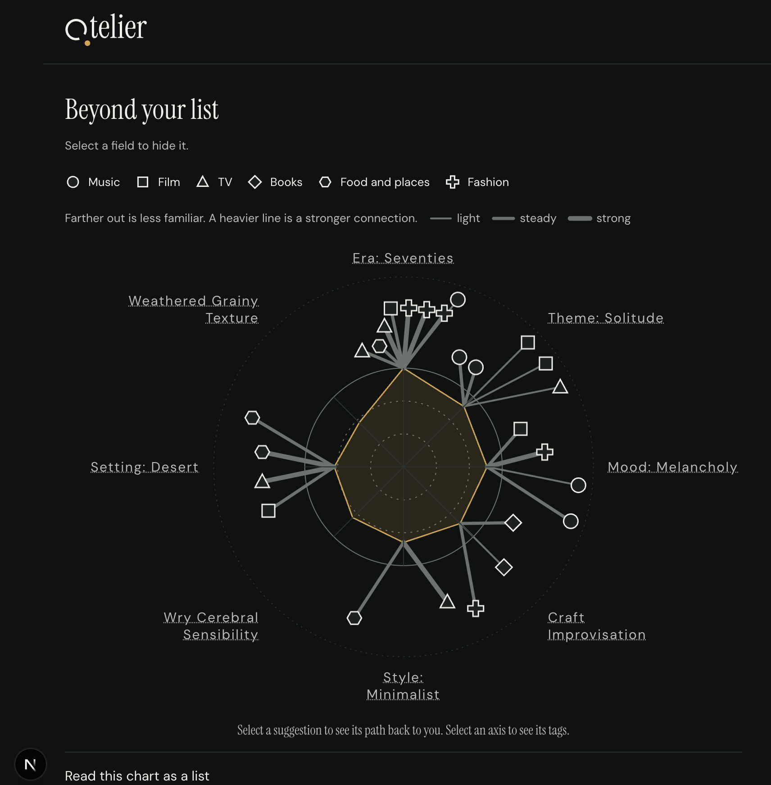

# Atelier

What is "taste"? And why is it well on its way to extinction today?

In the arts, taste is the ability to know what's good and what's bad, and, most importantly, to articulate it. Algorithms now feed us more of what we already love, and our preferences stop being our own.

Atelier helps people escape this taste vacuum.

Tell it a few things you love and why. It draws your taste as a chart, then suggests picks from music, books, fashion, food and places, film and TV at the edge of it: connected, but unfamiliar. Every pick shows its path back to you. The agent has no taste of its own. Grounded in Qloo’s taste graph, it’s a instrument for developing yours.

**[Live demo](https://atelier-ten-teal.vercel.app)** 


**Synthetic/mock data only. Real screenshots are in the Devpost gallery**
The axes come from the reasons you gave for the things you love, aligning with Qloo's tags. The filled yellow shape is your profile, the size being relative to your most weighted themes. The shapes surrounding are suggestions, the distance an indicator of how unfamiliar it is to you based on your profile. The lines are the connection with heavier lines indicating a stronger connection.

## Try it in 60 seconds

1. Open the [demo](https://atelier-ten-teal.vercel.app). No account needed.
2. Add 3 things you love across at least 2 fields, each with a one-line "why".
3. Choose See my taste to see it drawn as a chart.
4. Choose Look past the edge, then select a suggestion to see its path back to you.

If the demo shows "resting": its free daily allowance is used up, so it pauses rather than fail. It reopens within a day, and anything already on screen or saved still shows.

## Why this needs Qloo

A plain LLM can name things that sound related, but it can't show why they are, and it drifts toward what is already famous. Qloo gives Atelier what that needs:

- **Grounding.** Picks share real taste-graph tags with your inputs, so the theme on every path is retrieved.
- **Distance on purpose.** A popularity cap and rank within each pool keep picks off the obvious end.
- **Exclusion.** Your inputs and the picks already shown are left out of the next pool.
- **Explainability.** Each result says which of your inputs drove it, and that input becomes the start of the path.

## Who it's for

People sick of the recommendation loops created by companies to keep you trapped on their platform. Atelier asks what connects the things you love, looks for that connection in fields you may not have explored yet, and shows its reasoning so you can agree, disagree and say why.

## How it works

1. **Inputs and reasons.** You name 3 to 10 things you love across at least 2 fields, each with a one-line "why".
2. **Profile chart.** Qloo's taste analysis returns tags for your inputs, grouped into up to 6 axes on an attribute chart.
3. **Picks at the edge.** Each field gets one Qloo pool. Code keeps candidates that are far from your profile but clear a connection floor that never drops.
4. **A stored path per pick.** Your input, the shared theme, an optional lineage hop, then the pick. The explanation is written from that path only.
5. **Your reaction.** Say a pick is not you, not right now, worth trying or worth exploring, in your own words. A liked pick can join your collection of inputs, and the edges move.
6. **Provenance.** Every hop is labeled Sourced or Inferred. Lineage and readings come only from retrieved text and are left out when nothing is found.

**Code computes, the model chooses and explains.** Code resolves user inputs, scores reach and connection, enforces the floor, builds paths and counts calls. The model (Anthropic) picks a theme per field from options code offers, decides on re-queries from signals code computes, and writes the short explanations, which code checks before they are shown. There are no taste scores, rankings or audience metrics anywhere in the product.

```
resolve seeds (/search)
  -> why words to tags (/v2/tags, semantic search)
  -> taste analysis (profile tags)  -> axes
  -> preflight: validate the run's params for all six types
  -> model picks a theme per field (from axes code offers)
  -> one /v2/insights pool per field (weighted seeds, explainability on)
  -> code scores reach and connection, flags empty / weak / too obvious
  -> model may re-query (at most 2), from actions code computed
  -> code assigns bands and builds paths
  -> references for finalists (lineage, readings), when sources exist
  -> model writes the explanation of each path, code checks it
```

## How Qloo is used

| Capability | Used for |
|---|---|
| `/search` | Resolving what you typed to an entity. Ambiguous titles show a chooser. |
| `/v2/tags` with semantic search | Mapping the words of a "why" to tags. |
| Taste analysis (`/v2/insights`, tag results) | One call over all seeds. The tags become the profile and its axes. |
| `/v2/insights` for entities, by POST | One pool per field: weighted seeds, a popularity cap, seeds and shown picks excluded, explainability on. |
| Entity properties | Lineage (influences, similar brands) and style descriptions for readings. |

Rules the client enforces:

- **Host lock.** One module, `src/lib/qloo/client.ts`, server-side only, refuses any host other than `hackathon.api.qloo.com`.
- **Param validation.** Every `/v2/insights` param must be listed or confirmed for its entity type in `src/lib/qloo/registry.ts`. Qloo silently ignores invalid params, so the client throws instead of sending them.
- **Rank-based popularity.** Qloo's popularity bunches near 1, so "obscure" is decided by rank within the pool, never by an absolute cutoff.

## Quickstart

```bash
git clone https://github.com/jpozuna/atelier.git && cd atelier
npm install
# create .env with QLOO_BASE_URL, QLOO_API_KEY, QLOO_MODE=record, ANTHROPIC_API_KEY and ATELIER_MODEL
# (every variable is listed in docs/SETUP.md)
npm run dev
```

Full setup (Supabase, env vars, picks gate): [docs/SETUP.md](docs/SETUP.md)

## Docs

- [Setup and environment variables](docs/SETUP.md)
- [Call budget, caching, demo guard](docs/OPERATIONS.md)
- [Evals and measured judge agreement](docs/EVALS.md)
- [Design decisions](docs/DECISIONS.md)
- [API spike report](docs/spike-report.md)

## Limitations

- No social layer: no sharing, following or comparing with others.
- Six fields only. Architecture, cars and theater have no Qloo entity type. Using Qloo’s data and LLM reasoning could be used to put adjacent markers. It’s an area to further explore since those fields also contribute to a person’s taste. 
- Lineage exists for music, film, TV and fashion. Books and places have none.
- Food and places and fashion share fewer tags with other fields, so their picks can be thin.
- Thresholds (connection floor, band edges) are starting values, not yet tuned on real pools.
- Ran low on Anthropic API credits so switched to Haiku from Sonnet late in development as cut saving measure. Robustness of card text has been decreased due to this.
- 3 of 6 eval judges are below the 80% agreement target ([details](docs/EVALS.md#measured-agreement)).

The full list is in [docs/EVALS.md](docs/EVALS.md#limitations-in-detail).

## The Qloo data rule

No Qloo response data is committed to this repository: no entity names, entity ids, tag ids, raw JSON, or screenshots showing picks. Fixtures are synthetic, the only cache of Qloo data is server-side and private, and `npm run evals` checks the working tree and git history for it on every run.

## License and attributions

- Atelier is released under the [MIT License](LICENSE).
- **Qloo** taste data is used under the hackathon terms and not redistributed here.
- **Wikidata** (CC0) supplies lineage hops for film, TV and fashion.
- **Anthropic** API for the agent's model calls.
- **Fonts** Instrument Serif, DM Sans and DM Mono, under the SIL Open Font License 1.1.
