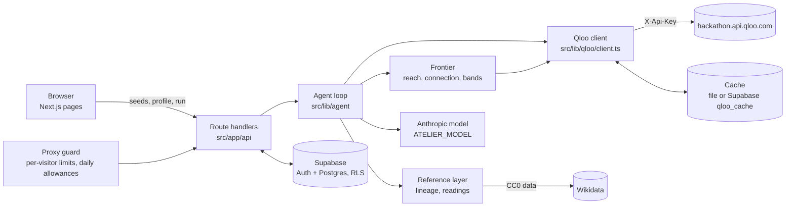

# Atelier

Atelier helps people develop taste, not just feed it.

You tell it a few things you love and, in a line each, why. It draws your taste as a profile on an attribute chart, then suggests picks from other fields that sit at the outer edge of that profile: unfamiliar, but connected. Every pick shows the path back to you and why it was chosen. The agent has no taste of its own. It is grounded in [Qloo's](https://www.qloo.com/) taste graph and works as an instrument for developing yours.

Built for the Qloo Agentic Hackathon. Licensed under MIT.

<!-- TODO(manager): add the deployed demo URL and the demo video link here once they exist. -->

## Who it is for

Creatives and students who are stuck in recommendation loops and want a point of view. Most recommenders return more of what you already like. Atelier asks what connects the things you love, then looks for that connection in fields you have not explored, and shows its reasoning so you can agree, disagree and say why.

## How it works

1. **Seeds and reasons.** You pick a field (music, film, TV, books, food and places, or fashion), name something, and answer a one-line "why do you love it". You repeat this across fields. A few minutes is enough: the screen asks for at least 3 seeds across 2 fields and accepts up to 10.
2. **A profile drawn as a chart.** Qloo's taste analysis returns tags for your seeds. They are grouped by tag type into 6 to 8 axes on an attribute chart. Each axis shows the tags behind it. An axis is named by the model only from its own tag words; if the name fails the checks, a plain label from the tag type is used instead.
3. **Picks at the edge.** For each field, code builds a pool of candidates from Qloo, scores each one for reach (how far from your profile: different field, fewer shared tags, less familiar) and for connection (how specific the shared tags are), and keeps only candidates that clear a connection floor. The floor never drops. Picks come in four degrees: calibration (close, so you can correct the agent, at most 6), then low, medium and high stretch (moderate, high and extreme in code). At most 20 stretch picks are shown, the strongest-connected first, split about evenly across the three degrees, and no field holds more than 40% of them when the fields have the depth for it. Fewer are shown rather than padding.
4. **A stored path for every pick.** Each pick keeps its path: your seed, the shared theme (the tags in common), an optional lineage hop, then the pick. The explanation is written from that path only.
5. **Provenance.** Theme and lineage hops are labeled Sourced or Inferred, with a visible word and a line style, not color alone. Lineage and symbolic readings come only from retrieved text, are labeled a reading, and are left out when nothing is retrieved. Sourced and inferred are never merged.
6. **Your reaction in your own words.** You can say a pick is not right now, that you will try it, that you want to explore it, or that it is not for you (with a box for why). "Not me" on a calibration pick sets it aside and re-runs that field only. After you try something, a follow-up asks how it went and why; a liked pick can join your seeds, and the edges move.
7. **Final reasoning, not the whole trace.** Selecting a suggestion shows only its final reasoning: where it sits on the chart (the axis it is beside and its stretch), the card's explanation and path, and its sources. The step-by-step trace is kept server-side in a private run log, not shown.
8. **A list you can work with.** Suggestions are one list, sortable by field or stretch, with fields you can hide. Tick one or several to see them together on one chart. Line weight on the chart shows how strongly a pick connects (light, steady, strong), never as a number. Axis tags are chips; a chip lists everything in this run that shares that tag.
9. **Learning from signals.** For signed-in people, picks set aside or turned down stay out of the next run. Themes behind saved picks are leaned toward, and themes behind turned-down picks are leaned away from. It uses only explicit signals and is off in replay mode, so the public demo does not use it.

### The division of labor

Code computes, the model chooses and explains.

- **Code** resolves seeds, computes reach, connection, rarity and popularity rank within each pool, sets the bands, enforces the floor, builds paths, fetches references, validates every piece of model text, and counts calls.
- **The model** (Anthropic, `ATELIER_MODEL`) chooses one theme per field from options code computed, decides whether to re-query when code flags a pool as empty, weak or too obvious (choosing among actions code offers), and writes the short explanations. Model text that uses internal terms, invents descriptions, restates the lineage, or contains numbers about taste is rejected, and a plain deterministic sentence built from the path is used instead.

There are no taste scores, rankings or audience metrics anywhere in the product. Reach, connection and popularity exist for code and evals only. `/api/run` strips them before anything reaches the browser.

### The agent loop

```
resolve seeds (/search)
  -> why words to tags (/v2/tags, semantic search)
  -> taste analysis (profile tags)  -> axes
  -> preflight: validate the run's params for all six types
  -> model picks a theme per field (from axes code offers)
  -> one /v2/insights pool per field (weighted seeds, explainability on)
  -> code scores reach and connection, flags empty / weak / too obvious
  -> model may re-query (at most 2), from actions code computed
  -> code assigns bands and builds paths
  -> references for finalists (lineage, readings), when sources exist
  -> model writes the explanation of each path, code checks it
```

## How Qloo is used

All Qloo calls go through one module, `src/lib/qloo/client.ts`. It is server-side only, sends the key in the `X-Api-Key` header, and refuses any host other than `hackathon.api.qloo.com`.

| Qloo capability | Used for |
|---|---|
| `/search` | Resolving what you typed to an entity. One call per submit; ambiguous titles show a chooser. Food and places are searched around a configurable center. |
| `/v2/tags` with semantic search | Mapping the words of a "why" to tags, on submit only, deduplicated by name. |
| Taste analysis (`/v2/insights`, tag results) | One call over all seeds. The tags it returns, with their affinity and tag type, become the profile and its axes. |
| `/v2/insights` for entities, by POST | One pool per field. Seeds are sent as `{id, weight}`, so the seeds on the axis being explored weigh more. A popularity cap keeps the pool off the popular end, every seed and every pick already shown is excluded, and explainability is on so each result says which seed drove it. That seed becomes the anchor of the path. |
| Entity properties | Lineage fields (influences for music, `influenced_other_media`, similar brands) and `style_description` for readings. |

Rules the client enforces:

- **Params are validated before sending.** Every `/v2/insights` param must be listed or confirmed for that entity type in `src/lib/qloo/registry.ts`, seeded from the official Entity Type Parameter Guide and updated by our API spike. Qloo silently ignores invalid params and the results still look fine, so the client throws on anything unlisted instead of sending it. Tags used as signals or filters must be tag ids, never free text.
- **Never** `/recommendations` or `/recs`.
- **Popularity is handled by rank.** Qloo's popularity bunches near 1, so "obscure" is decided by rank within the pool and a per-field popularity cap, never by an absolute cutoff.

### Call budget and caching

The hackathon key allows 10,000 calls a month and 5 per second, and has to last through judging. So:

- Onboarding makes at most 2 live calls per seed (the search and its "why" tags), for at most 10 seeds.
- Building the profile makes 1 call.
- A run makes at most 12 live calls (a typical run is 6 pools plus at most 2 re-queries). The client refuses the thirteenth.
- A repeat view makes 0: the browser keeps the result and the run plan, and the same requests replay from the cache.
- A "not me" re-run looks at one field only (one pool plus at most 2 re-queries).
- At most 4 requests are in flight, starts are spaced to stay under 5 per second, and 429s back off and retry.
- Every response is cached after the client strips bulky fields. Locally the cache is a file under `.qloo-private/cache`. In production it is a private Supabase table, `qloo_cache`, that no browser role can read.
- Below `QLOO_RESERVE` remaining monthly calls, live calls are refused.
- Dev and evals run from cache or replay by default. Any live script prints its call count first.

## Architecture



- **App:** Next.js (App Router) and TypeScript. Plain SVG for the chart, no chart library.
- **Accounts and storage:** Supabase Auth (email magic link, no password) and Postgres with row-level security on every table. A guest can do onboarding, see the chart, get calibration and edge picks without an account. An account is needed only to save and revisit.
- **Model:** the Anthropic API, model id from `ATELIER_MODEL`. Calls are forced tool calls with bounded output. With no `ANTHROPIC_API_KEY`, the app still runs a deterministic path with plain axis labels and path-built explanations.
- **Streaming:** `/api/run` streams trace events and then the result as server-sent events. The browser shows the result; the trace stays in the private run log.

| Path | Holds |
|---|---|
| `src/app/` | routes, pages, route handlers (`/start`, `/taste`, `/picks`, `/saved`, `/auth`, `/api`) |
| `src/components/` | onboarding, chart, card, deck (picks screen and suggestion list), reactions, shell |
| `src/lib/qloo/` | client, param registry, cache |
| `src/lib/agent/` | loop, tools, prompts, text checks, `config.ts` (every tunable number) |
| `src/lib/profile/`, `frontier/`, `refs/`, `seeds/` | tags to axes, reach and connection, lineage and readings, seed lookup |
| `src/lib/db/`, `supabase/migrations/` | Supabase access and schema |
| `src/lib/guard/`, `src/proxy.ts` | demo guard |
| `evals/` | scorers, judges, synthetic fixtures, runner |
| `scripts/spike/` | the API spike scripts (their output is never committed) |
| `docs/` | brief, decisions, spike report (counts and field names only), submission texts |

Design decisions and the reasons for them are in `docs/DECISIONS.md`. What the API spike found is in `docs/spike-report.md`.

## Setup from a clean checkout

You need Node 22.12 or newer (an even-numbered release; developed on 22), npm, a Supabase project (or Docker for a local one), an Anthropic API key, and a Qloo hackathon key.

```bash
git clone <this repo>
cd atelier
npm install
cp .env.example .env     # then fill it in, see below
npm run dev              # http://localhost:3000
```

For a fresh checkout set `QLOO_MODE=record` in `.env` (see below). The default, `replay`, answers only from a cache, and a fresh checkout has none, so every lookup would return `lookups_off`.

`.env` is gitignored. Never commit it, and never put a secret in a `NEXT_PUBLIC_*` variable.

### Environment variables

| Variable | What it does |
|---|---|
| `QLOO_BASE_URL` | Must be `https://hackathon.api.qloo.com`. The client refuses any other host (staging and production return 401 for the hackathon key). |
| `QLOO_API_KEY` | Your Qloo hackathon key. Server-side only. |
| `QLOO_MODE` | `replay` (default): answer only from the cache, never call Qloo, and report a lookup as unavailable on a miss. `record`: call Qloo on a miss, then cache the answer. `live`: always call and also store (burns calls, so use it rarely). |
| `QLOO_RESERVE` | Remaining monthly calls below which live calls are refused. The remaining count is read from Qloo's response headers, so the reserve applies once at least one live response has reported it. `.env.example` uses 6000; the deployed demo suggests about 300. |
| `QLOO_CACHE` | `file` or `supabase`. Unset means `supabase` in production when the Supabase URL and service role key are set, otherwise `file`. |
| `ATELIER_PLACES_LOCATION`, `ATELIER_PLACES_RADIUS` | Center (`lat,lon`) and radius in miles for food and places lookups. Optional; defaults to New York, 20. |
| `ANTHROPIC_API_KEY` | Anthropic key. Server-side only. Without it the app uses its deterministic fallbacks. |
| `ATELIER_MODEL` | Model id for the agent. The default in `.env.example` is `claude-sonnet-5-5`. |
| `ATELIER_JUDGE_MODEL` | Model for the eval judges only. Falls back to `ATELIER_MODEL`. Prefer a different model from the generator. |
| `NEXT_PUBLIC_SUPABASE_URL`, `NEXT_PUBLIC_SUPABASE_ANON_KEY` | Supabase project URL and anon key. Public by design. |
| `SUPABASE_SERVICE_ROLE_KEY` | Service role key. Server-side only. Used for the private Qloo cache table, never in the browser or the proxy. |
| `SITE_URL` | Site origin for magic-link redirects. `https` in production; `http` only on localhost. |
| `ATELIER_CONTACT` | An email or project URL for the Wikimedia User-Agent. Without it the Wikidata lineage lookups are skipped and Qloo-sourced lineage still works. |
| `ATELIER_GUARD` | The demo guard is on in production and off in dev. Set `1` to try it in dev, `0` to turn it off in production. |
| `ATELIER_RUNS_PER_HOUR` | Runs per visitor per hour. Default 3. |
| `ATELIER_DAILY_MODEL_CALLS`, `ATELIER_DAILY_QLOO_CALLS` | Daily worst-case allowances (default 480 each) before the demo rests. |
| `ATELIER_REST` | Set to `1` to force the calm "demo is resting" state. |
| `ATELIER_DEMO` | Leave unset in the deployed demo so `QLOO_RESERVE` can rest it. `1` bypasses the reserve. |

### Supabase

Hosted project:

1. Create a project. Under Auth, keep Email sign-in on, turn **Confirm email** on, and leave anonymous sign-ins off.
2. `supabase login`, then `supabase link --project-ref <ref>`, then `supabase db push`. This applies `supabase/migrations/` in order (tables for profiles, seeds, picks, reactions, profile snapshots, the private Qloo cache, the private guard counters and the private run log, all with RLS). If the project already has tables, compare them with the migration before you push.
3. Copy the project URL, anon key and service role key into `.env`.
4. Under Auth, URL Configuration, set Site URL to your origin and add `<origin>/auth/callback` (and `http://localhost:3000/auth/callback` for local use) to Redirect URLs.
5. The default Supabase mailer is rate limited. Set up custom SMTP if many people will sign in.

Local stack (needs Docker): `supabase start`, then `supabase db reset`, then `supabase status -o env` for the local URL and keys. Magic-link emails appear in the local mail catcher at http://127.0.0.1:54324.

The sign-in link must be opened in the same browser that requested it.


### Qloo modes in practice

A fresh checkout has no cache, and `replay` answers only from a cache, so with an empty cache every lookup returns `lookups_off`. Set `QLOO_MODE=record` with your own hackathon key (or bring a cache you recorded). Record mode calls Qloo only on a miss and caches everything it fetches, so each profile costs its calls once. Qloo data from your own key is cached under `.qloo-private/`, which is gitignored; see the data rule below.

### Open the picks gate

The edge picks need Qloo's POST body to honor three params: the popularity cap, the exclusion list and explainability. They stay refused by the client until a check confirms them for every type. On a new setup:

1. `node scripts/spike/04-post-check.mjs --dry-run` prints how many live calls the check will make (7: one pool for each of the six types plus one taste analysis) and makes none.
2. With the project owner's OK, run it live: `QLOO_LIVE=1 QLOO_BUDGET=7 node scripts/spike/04-post-check.mjs`. Its output goes to `.qloo-private/`.
3. Record the names it verified in `POST_BODY.confirmedBodyParams` in `src/lib/qloo/registry.ts`.

Until then `/api/run` answers `picks_not_enabled` and `/picks` shows "Picks aren't ready yet". Onboarding and the chart work without it.

### Scripts

| Command | Does |
|---|---|
| `npm run dev` | Dev server |
| `npm run build`, `npm start` | Production build and server |
| `npm test` | Unit tests (Vitest). Synthetic data and fake network only |
| `npm run lint`, `npm run typecheck` | Lint and type check |
| `npm run evals` | Synthetic evals: the code scorers over fixtures, plus repo hygiene. Zero Qloo calls |
| `npm run evals:judges` | LLM judges over synthetic labeled cards, with a fake model by default |
| `QLOO_LIVE=1 npm run evals:live` | Live evals. Prints the expected live call count first. Suites live in `evals/live/` (see Evals) |

## Evals

Evals are written first, and the code scorers run in CI-safe synthetic form.

- **Code scorers (`npm run evals`).** Thirteen scorers run over synthetic traces and run results, each with at least one passing and one failing case: repo hygiene, param validity, call budget, dial behavior, re-query logic, domain coverage, path presence, distinctive hop, reach margin, connection floor, provenance, card completeness and seed resolution. Repo hygiene scans the working tree and the added lines in git history for Qloo-shaped ids, tag ids, secrets and images.
- **LLM judges (`npm run evals:judges`).** Six judges read a card and its path: bridge groundedness, bridge quality, stretch defensibility, lineage groundedness, reading restraint and rubric fit (discernment, pattern recognition, idiosyncrasy). Code checks each verdict: a judge must quote the card, and a quote that is not on the card voids the verdict. Each judge is calibrated against labeled synthetic cards, including cards that try to instruct the judge. By default the run uses a fake model that replays the labels, which tests the plumbing and says nothing about agreement. A real run needs `ATELIER_JUDGES_LIVE=1` and `ANTHROPIC_API_KEY`, prints its model call count first, and is capped. It makes no Qloo calls.
- **Live evals (`QLOO_LIVE=1 npm run evals:live`).** Spend Qloo calls, so they print the count first and are meant to be run locally with approval. Recordings go to `.qloo-private/evals/`. Suites live in `evals/live/`: a post-check entry that only prints instructions for the 7-call script above and makes no call itself, and a smoke run that makes one end-to-end run through the real client and then runs the code scorers over what it recorded (at most 9 Qloo calls, recorded privately).

**Measured agreement** (first real run, 2026-10-22, `claude-sonnet-5-5` at effort `low`, 71 calls, target 80% per judge):

| Judge | Agreement with labels | Meets target |
|---|---|---|
| Bridge groundedness | 11/11 (100%) | yes |
| Lineage groundedness | 11/11 (100%) | yes |
| Reading restraint | 12/12 (100%) | yes |
| Stretch defensibility | 10/13 (77%) | no |
| Bridge quality | 9/13 (69%) | no (orders high above low: 4.0 vs 1.8) |
| Rubric fit | 4/11 (36%) | no (orders high above low: 2.4 vs 1.0, but scores low overall) |

The three pass/fail groundedness judges can be relied on. The two 1-to-5 scoring judges rank good cards above bad ones but score lower than the labels, and stretch defensibility is just under the target. Treat those three as rough signals until they are recalibrated.

## The demo guard

The deployed demo is free and has to survive judging, so a proxy (`src/proxy.ts`) guards the four routes that spend calls: `/api/run`, `/api/profile`, `/api/profile/why` and `/api/seeds/resolve`. It is on in production.

- Per-visitor limits by IP and declared body-size caps. For runs the limit is 3 an hour and 8 a day; a first run, a "Not me" re-run and a follow-up each count as a run.
- Two daily allowances charged at the worst case of each request: model calls (480 a day by default) and live Qloo calls. When either is used up, the demo shows a calm "resting" state instead of an error. Picks already on screen and anything you saved still show.
- `GET /api/demo-status` reports open or resting without spending anything.
- The monthly reserve (`QLOO_RESERVE`) is enforced by the Qloo client and reaches the screens as the same resting state.
- Security headers are set in `vercel.json`. A test scans the built client bundle for server-only names and key shapes.

The hackathon key is active through the end of judging and deactivated after the hackathon closes. After that, live Qloo calls fail by design, and the demo can only show what is already cached or saved.

<!-- TODO(manager): confirm the deployed environment settings (QLOO_BASE_URL, QLOO_MODE=record, QLOO_RESERVE about 300, ATELIER_DEMO unset, Supabase cache adapter) and add testing instructions for judges. -->

## Limitations

Stated plainly, so a reader can judge what the project does and does not do.

- **No social layer.** There is no sharing, no finding people, no visibility settings and no compare-with-others overlay. The brief put social features out of scope for v1, and this is the largest gap against a full product. There is also no taste history beyond saved picks and reactions.
- **Six fields.** Music, film, TV, books, food and places, and fashion. Architecture, cars and theater are out because Qloo has no entity type for them.
- **Lineage exists for only some fields.** Music (from Qloo's influence fields), film and TV (Qloo plus Wikidata), and fashion (similar brands plus Wikidata). Books and places have none, and their cards show no lineage hop. Fashion's source is similarity, not influence, and the hop says so. A hop sourced from Qloo shows "Source: Qloo" with no link, because Qloo has no per-entity page. Wikidata hops link to the item and credit Wikidata (CC0).
- **Readings come only from style descriptions** on film, TV and brands, shown as an excerpt and labeled a reading. Plot summaries, biographies and descriptions are not readings. Everything else gets no reading.
- **Some fields connect through fewer shared tags.** Food and places and fashion have their own tag vocabularies, so paths into and out of them have fewer shared tags to rest on. A field that cannot meet the connection floor is shown thin, with a note, and is never padded with popular or random picks.
- **Chart encoding in v1.** Position on the picks screen follows the pick's degree band, not a continuous distance, and every connection line has the same weight. The public run data deliberately carries no connection number.
- **Anchor seeds are coarse.** Qloo's explainability spreads credit across seeds, so the seed a path names is the top contributor, not a dominant one; a path says when the link is thin. Taste analysis is one call over all seeds, so there is no per-seed tag list.
- **The "why" is one short line.** Semantic tag search keeps the first concept of a long sentence.
- **Axes** are grouped by Qloo tag type. Model-written names are checked strictly and many may fall back to plain labels. Fewer than six axes are reported as such, not padded.
- **Follow-up** adds a liked pick as a seed and re-queries that field. It does not rebuild the profile tags and axes.
- **Counters** for the demo guard are in Supabase (`guard_counters`) in production, and fall back to memory, per server instance, when the database is unreachable.
- **Edge picks sit behind a parameter gate.** The POST body params that the pool relies on (the popularity cap, the exclusion list and explainability) are listed as confirmed in `src/lib/qloo/registry.ts` only after the check in `scripts/spike/04-post-check.mjs`. While the list is empty, `/api/run` answers `picks_not_enabled` and `/picks` shows a calm "not ready" state.

<!-- TODO(manager): update or remove the gate paragraph above once POST_BODY.confirmedBodyParams is filled in. -->

Not yet verified, and written to be updated when it is:

- Thresholds (connection floor, band edges, the too-obvious test) are starting values. They have not been tuned against recorded real pools.
- The model-text checks may refuse some real sentences and fall back to plain text. They have not been tuned against real model output.
- The end-to-end run against live Qloo data and a real model.
- Measured agreement of the LLM judges with their labels.
- The magic-link round trip on the hosted project. (The migrations and RLS tests pass on a local stack and on the hosted database.)
- Browser, keyboard, phone-width and dark-theme review of the screens.

## The Qloo data rule

No Qloo response data is committed to this repository. That means no entity names, entity ids, tag ids, raw JSON, or screenshots showing picks. Fixtures are synthetic: invented names and ids shaped like `00000000-0000-4000-8000-0000000000NN`. Recordings, spike output and eval runs go to `.qloo-private/`, which is gitignored. The only cache of Qloo data is server-side and private. `npm run evals` checks this on every run, including git history.

## Licenses and attributions

- Atelier is released under the [MIT License](LICENSE).
- **Qloo.** Taste data comes from the Qloo hackathon API and is used under its hackathon terms. It is not redistributed in this repository.
- **Wikidata.** Lineage hops for film, TV and fashion use Wikidata, which is CC0. Atelier sends a User-Agent carrying the contact you set in `ATELIER_CONTACT` and backs off on rate limits. Wikipedia text is not used.
- **Anthropic.** The agent's model calls use the Anthropic API.
- **Fonts**, all under the SIL Open Font License and self-hosted at build time: Cormorant Garamond (wordmark and large headings), Newsreader (reading text) and Inter (small labels).
- Dependencies are listed in `package.json` and `package-lock.json` under their own licenses.

The repository's first commit is dated Oct 14, 2026.

<!-- TODO(manager): confirm against the official rules that Oct 14 falls inside the submission period, or add a note about what was significantly updated. -->
