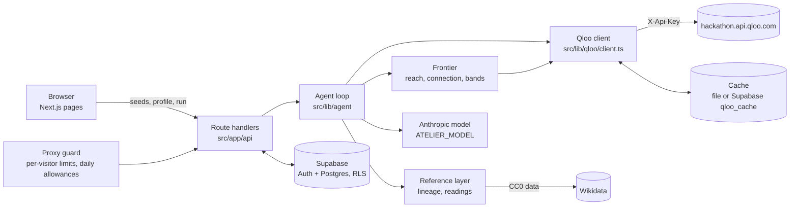

# Setup

How to run Atelier from a clean checkout, what every environment variable does, and how the code is laid out.

## Prerequisites

Node 22.12 or newer (an even-numbered release; developed on 22), npm, a Supabase project (or Docker for a local one), an Anthropic API key, and a Qloo hackathon key.

```bash
git clone https://github.com/jpozuna/atelier.git
cd atelier
npm install
# create .env with the variables below
npm run dev              # http://localhost:3000
```

For a fresh checkout set `QLOO_MODE=record` in `.env` (see [Qloo modes](#qloo-modes-in-practice)). The default, `replay`, answers only from a cache, and a fresh checkout has none, so every lookup would return `lookups_off`.

`.env` is gitignored. Never commit it, and never put a secret in a `NEXT_PUBLIC_*` variable.

## Environment variables

| Variable | What it does |
|---|---|
| `QLOO_BASE_URL` | Must be `https://hackathon.api.qloo.com`. The client refuses any other host (staging and production return 401 for the hackathon key). |
| `QLOO_API_KEY` | Your Qloo hackathon key. Server-side only. |
| `QLOO_MODE` | `replay` (default): answer only from the cache, never call Qloo, and report a lookup as unavailable on a miss. `record`: call Qloo on a miss, then cache the answer. `live`: always call and also store (burns calls, so use it rarely). |
| `QLOO_RESERVE` | Remaining monthly calls below which live calls are refused. The remaining count is read from Qloo's response headers, so the reserve applies once at least one live response has reported it. Default 6000; the deployed demo uses 300. |
| `QLOO_CACHE` | `file` or `supabase`. Unset means `supabase` in production when the Supabase URL and service role key are set, otherwise `file`. |
| `ATELIER_PLACES_LOCATION`, `ATELIER_PLACES_RADIUS` | Center (`lat,lon`) and radius in miles for food and places lookups. Optional; defaults to New York, 20. |
| `ANTHROPIC_API_KEY` | Anthropic key. Server-side only. Without it the app uses its deterministic fallbacks. |
| `ATELIER_MODEL` | Model id for the agent, for example `claude-sonnet-5-5`. Theme, re-query and card calls default to `claude-sonnet-5-5` when it is unset; the axis namer runs only when it is set (otherwise axes get plain labels). |
| `ATELIER_JUDGE_MODEL` | Model for the eval judges only. Falls back to `ATELIER_MODEL`. Prefer a different model from the generator. |
| `NEXT_PUBLIC_SUPABASE_URL`, `NEXT_PUBLIC_SUPABASE_ANON_KEY` | Supabase project URL and anon key. Public by design. |
| `SUPABASE_SERVICE_ROLE_KEY` | Service role key. Server-side only. Used for the private Qloo cache table, never in the browser or the proxy. |
| `SITE_URL` | Site origin for magic-link redirects. `https` in production; `http` only on localhost. |
| `ATELIER_CONTACT` | An email or project URL for the Wikimedia User-Agent. Without it the Wikidata lineage lookups are skipped and Qloo-sourced lineage still works. |
| `ATELIER_GUARD` | The demo guard is on in production and off in dev. Set `1` to try it in dev, `0` to turn it off in production. |
| `ATELIER_RUNS_PER_HOUR` | Runs per visitor per hour. Default 3. |
| `ATELIER_DAILY_MODEL_CALLS`, `ATELIER_DAILY_QLOO_CALLS` | Daily worst-case allowances (default 480 each) before the demo rests. |
| `ATELIER_REST` | Set to `1` to force the calm "demo is resting" state. |
| `ATELIER_DEMO` | Leave unset in the deployed demo so `QLOO_RESERVE` can rest it. `1` bypasses the reserve. |

## Supabase

Hosted project:

1. Create a project. Under Auth, keep Email sign-in on, turn **Confirm email** on, and leave anonymous sign-ins off.
2. `supabase login`, then `supabase link --project-ref <ref>`, then `supabase db push`. This applies `supabase/migrations/` in order (tables for profiles, seeds, picks, reactions, profile snapshots, the private Qloo cache, the private guard counters and the private run log, all with RLS). If the project already has tables, compare them with the migration before you push.
3. Copy the project URL, anon key and service role key into `.env`.
4. Under Auth, URL Configuration, set Site URL to your origin and add `<origin>/auth/callback` (and `http://localhost:3000/auth/callback` for local use) to Redirect URLs.
5. The default Supabase mailer is rate limited. Set up custom SMTP if many people will sign in.

Local stack (needs Docker): `supabase start`, then `supabase db reset`, then `supabase status -o env` for the local URL and keys. Magic-link emails appear in the local mail catcher at http://127.0.0.1:54324.

The sign-in link must be opened in the same browser that requested it.

## Qloo modes in practice

A fresh checkout has no cache, and `replay` answers only from a cache, so with an empty cache every lookup returns `lookups_off`. Set `QLOO_MODE=record` with your own hackathon key (or bring a cache you recorded). Record mode calls Qloo only on a miss and caches everything it fetches, so each profile costs its calls once. Qloo data from your own key is cached under `.qloo-private/`, which is gitignored; see the data rule in the [README](../README.md#the-qloo-data-rule).

## The picks gate

The edge picks need Qloo's POST body to honor three params: the popularity cap, the exclusion list and explainability. The client refuses them until a check confirms them for a type. That check, `scripts/spike/04-post-check.mjs`, ran live on 2026-10-28 (7 calls: one pool for each of the six types plus one taste analysis) and confirmed all three for all six types. They are recorded in `POST_BODY.confirmedBodyParams` in `src/lib/qloo/registry.ts`, so the gate is open.

To re-check on a new key or if the API changes:

1. `node scripts/spike/04-post-check.mjs --dry-run` prints how many live calls the check will make (7) and makes none.
2. With the project owner's OK, run it live: `QLOO_LIVE=1 QLOO_BUDGET=7 node scripts/spike/04-post-check.mjs`. Its output goes to `.qloo-private/`.
3. Update the names it verified in `POST_BODY.confirmedBodyParams`.

## Scripts

| Command | Does |
|---|---|
| `npm run dev` | Dev server |
| `npm run build`, `npm start` | Production build and server |
| `npm test` | Unit tests (Vitest). Synthetic data and fake network only |
| `npm run lint`, `npm run typecheck` | Lint and type check |
| `npm run evals` | Synthetic evals: the code scorers over fixtures, plus repo hygiene. Zero Qloo calls |
| `npm run evals:judges` | LLM judges over synthetic labeled cards, with a fake model by default |
| `QLOO_LIVE=1 npm run evals:live` | Live evals. Prints the expected live call count first. See [EVALS.md](EVALS.md) |

## Architecture



- **App:** Next.js (App Router) and TypeScript. Plain SVG for the chart, no chart library.
- **Accounts and storage:** Supabase Auth (email magic link, no password) and Postgres with row-level security on every table. A guest can do onboarding, see the chart, get calibration and edge picks without an account. An account is needed only to save and revisit.
- **Model:** the Anthropic API, model id from `ATELIER_MODEL`. Calls are forced tool calls with bounded output. With no `ANTHROPIC_API_KEY`, the app still runs a deterministic path with plain axis labels and path-built explanations.
- **Streaming:** `/api/run` streams trace events and then the result as server-sent events. The browser shows the result; the trace stays in the private run log.

| Path | Holds |
|---|---|
| `src/app/` | routes, pages, route handlers (`/start`, `/taste`, `/picks`, `/saved`, `/auth`, `/api`) |
| `src/components/` | onboarding, chart, card, deck (picks screen and suggestion list), reactions, shell |
| `src/lib/qloo/` | client, param registry, cache |
| `src/lib/agent/` | loop, tools, prompts, text checks, `config.ts` (every tunable number) |
| `src/lib/profile/`, `frontier/`, `refs/`, `seeds/` | tags to axes, reach and connection, lineage and readings, seed lookup |
| `src/lib/db/`, `supabase/migrations/` | Supabase access and schema |
| `src/lib/guard/`, `src/proxy.ts` | demo guard |
| `evals/` | scorers, judges, synthetic fixtures, runner |
| `scripts/spike/` | the API spike scripts (their output is never committed) |
| `docs/` | brief, decisions, spike report (counts and field names only), submission texts |
