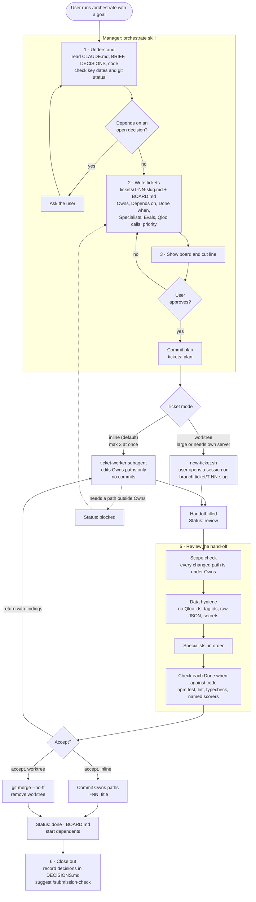
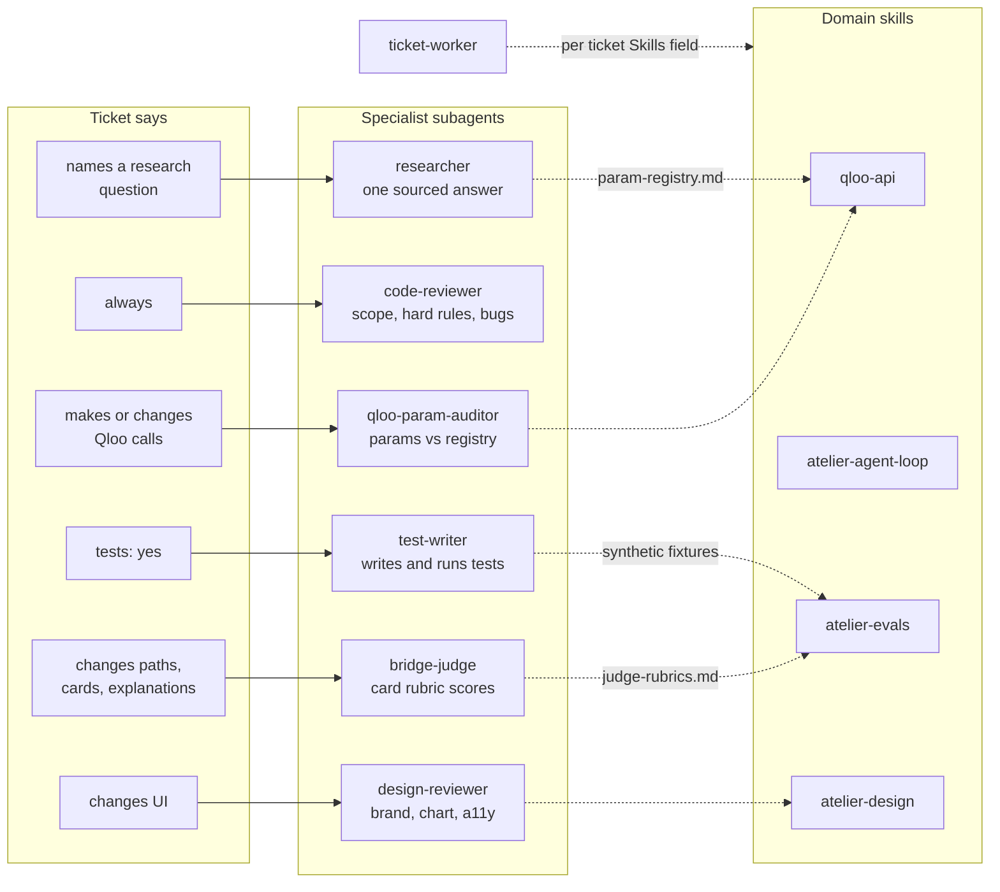

# Atelier build workflow

How agents build Atelier: the `orchestrate` manager splits work into tickets, `ticket-worker` subagents implement them, specialist subagents check each hand-off, and domain skills carry the rules every agent reads.

Source: `.claude/skills/`, `.claude/agents/`, `CLAUDE.md`. Update this file when a skill or agent definition changes.

## Ticket lifecycle

One pass of `/orchestrate`, from goal to committed tickets.

**Rules that keep tickets parallel**

- No path appears in two tickets' `Owns`. Shared files (registry, config, types, tokens, migrations, package.json) get their own ticket or stay with the manager.
- `Depends on` names ticket IDs. Dependents start only after those are done.
- Any ticket kind until Oct 29, 10 am; after that, only fixes for the submission.

**Why the manager runs specialists**

- Subagents cannot call other subagents, so a worker returns and the manager launches each specialist on that ticket.
- Specialists only read and report, except `test-writer`, which writes tests under the ticket's `Owns`.
- Nothing is pushed or deployed without the user's say-so.

## Specialists and skills

Which specialist runs on a ticket, and which skills each agent reads. Solid lines are runs; dotted lines are reads.

**Review order**

- `test-writer` first, then `code-reviewer`, then the auditor, judge and design reviewer where they apply.
- `researcher` runs only when a worker could not answer a named question.

**Manual-only skills**

- `/orchestrate`: the manager above.
- `/qloo-spike`: probes Qloo per domain and writes `docs/spike-report.md` (locked the domain list by Oct 19).
- `/submission-check`: pre-submit audit against the hackathon rules, suggested once P0 tickets are done.

## Agent roster

| Agent | Model | Tools | Job |
|---|---|---|---|
| `ticket-worker` | sonnet | Read, Grep, Glob, Edit, Write, Bash | Implements one ticket inside its Owns paths, fills Handoff, sets Status: review. Never commits. |
| `test-writer` | sonnet | Read, Grep, Glob, Edit, Write, Bash | Tests each Done when item plus edge cases with mocked clients and synthetic fixtures. Reports code bugs instead of fixing them. |
| `code-reviewer` | sonnet | Read, Grep, Glob, Bash | Scope violations first, then hard-rule violations, unmet criteria, bugs. Runs test and lint. |
| `qloo-param-auditor` | sonnet | Read, Grep, Glob, Bash | Checks every Qloo call site's endpoint, method, host and params against `registry.ts`, since Qloo silently ignores invalid params. |
| `bridge-judge` | opus | Read, Grep, Glob | Scores a card for groundedness, quality, stretch defensibility, lineage, reading restraint and rubric fit. JSON only. |
| `design-reviewer` | sonnet | Read, Grep, Glob, Bash | Checks brand, chart, cards, motion, accessibility and the reasoning panel. Code-only until a screenshot script exists. |
| `researcher` | sonnet | Read, Grep, Glob, WebSearch, WebFetch | Answers one question from the repo first, then official docs, marking verified versus inferred. |
