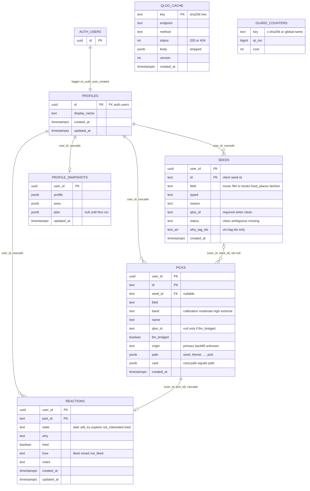

# Atelier database schema

The Supabase tables as of the two migrations on main. User tables hold seeds, picks and reactions per account; two private tables back the Qloo cache and the deploy guard.

Source: `supabase/migrations/20261019000000_init.sql`, `supabase/migrations/20261021000000_guard_counters.sql`. Update this file when a migration changes the schema.

**User tables**

- RLS on; owner-only policies for `authenticated`. Guests (`anon`) have no access.
- Composite keys `(user_id, id)` so a pick can only point at the same user's seed.
- No reach, connection or popularity is stored. Those are recomputed in code.
- `picks_path_shape` checks hops start with seed then theme and end with pick.

**Private tables**

- `qloo_cache` and `guard_counters`: RLS on, no policies, all grants revoked. Service role only.
- `guard_consume(hits, now_ms, do_commit)` admits or refuses a request's hits atomically, with advisory locks per key.
- Counter rows older than 24 hours are pruned on each commit.
